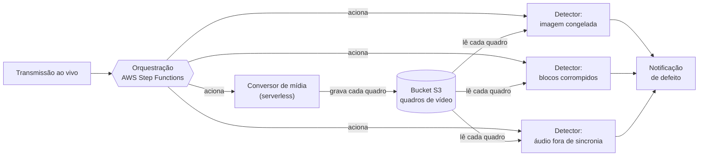
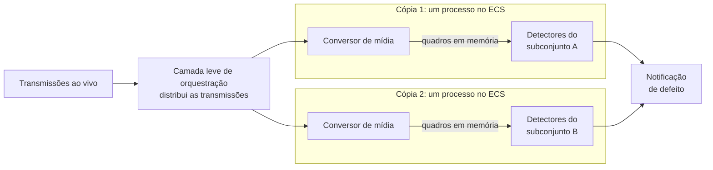
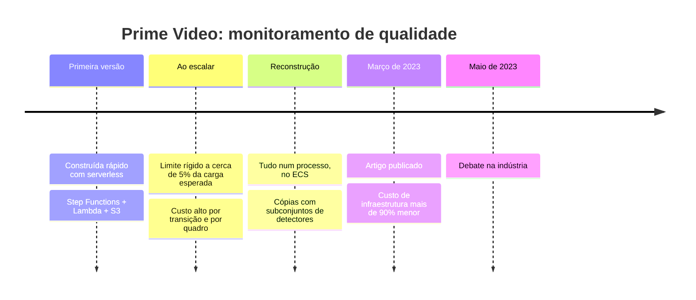

# Dossiê A: Amazon Prime Video, Monitoramento de Qualidade de Vídeo

**Trabalho Prático:** [01-enunciado-trabalho.md](01-enunciado-trabalho.md)

**Período do caso:** a mudança foi publicada pelo time de engenharia do Prime Video em março de 2023 e gerou um grande debate na indústria em maio de 2023.

> ⚠️ **Atenção:** este caso trata de **um serviço específico** dentro do Prime Video, não da plataforma inteira. Guarde essa informação: ela é importante para a análise.

> 📊 **Sobre os diagramas deste dossiê:** são simplificados e servem para **visualizar a estrutura** (o que existe e como as partes se ligam). Eles **não mostram a análise**: os quanta, o estilo da Aula 06 e o *trade-off* são com vocês.

---

## 1. O Contexto de Negócio

O Prime Video transmite milhares de canais e eventos **ao vivo** ao mesmo tempo. O time de **Análise de Qualidade de Vídeo** (*Video Quality Analysis*, VQA) mantém uma ferramenta que "assiste" automaticamente às transmissões procurando defeitos que o cliente perceberia:

* imagem congelada;
* blocos corrompidos na imagem;
* áudio fora de sincronia com o vídeo.

Quando encontra um defeito, a ferramenta dispara uma notificação em tempo real para que o problema seja corrigido.

A ferramenta já existia, mas **não tinha sido projetada para rodar em larga escala**. O objetivo do time passou a ser monitorar **todas** as transmissões, e não apenas uma amostra.

---

## 2. A Arquitetura Original (antes)

O time construiu a primeira versão como um **sistema distribuído usando componentes *serverless*** da AWS. Segundo o próprio time, essa escolha permitiu **construir o serviço rapidamente**, e em teoria cada componente poderia escalar de forma independente.

**Componentes:**

1. **Conversor de mídia:** recebe o fluxo de áudio e vídeo e o transforma em quadros (*frames*) de imagem e trechos de áudio decodificados.
2. **Detectores de defeitos:** algoritmos (alguns com modelos de *machine learning*) que analisam cada quadro e cada trecho de áudio procurando defeitos.
3. **Orquestração:** controla o fluxo entre os componentes. Foi implementada com **AWS Step Functions** (um serviço de máquinas de estado gerenciado pela AWS), acionando funções **AWS Lambda**.

**Como os dados circulavam:**

* O conversor gravava os quadros extraídos num *bucket* do **Amazon S3** (armazenamento de objetos na nuvem).
* Cada detector lia esses quadros do S3 para fazer a análise.
* A cada passo do fluxo, a máquina de estados do Step Functions registrava uma **transição de estado**.

**O fluxo de uma transmissão, antes:**

> Cada seta que passa pela orquestração é uma **transição de estado cobrada**, e acontecem várias por segundo, em cada transmissão. Cada quadro de vídeo faz **duas viagens pela rede**: uma para gravar no S3 e outra para cada detector ler.

---

## 3. O Problema

Ao aumentar o número de transmissões monitoradas, o time encontrou dois problemas:

**Limite de escala:** o sistema bateu num **limite rígido por volta de 5% da carga esperada**. O principal gargalo foi a orquestração: o serviço fazia **várias transições de estado para cada segundo de cada transmissão**, e rapidamente atingiu os limites da conta na AWS.

**Custo alto:**
* O Step Functions **cobra por transição de estado**. Com várias transições por segundo, por transmissão, a conta cresceu muito rápido.
* A troca de quadros pelo S3 gerava um volume enorme de requisições de gravação e leitura, um tipo de operação que a AWS cobra à parte. Transportar imagens entre componentes pela rede tinha um custo alto e constante.

O time chegou a considerar **corrigir cada gargalo separadamente**, mantendo a arquitetura distribuída, mas decidiu repensar a solução.

---

## 4. A Arquitetura Nova (depois)

O time **juntou todos os componentes num único processo**:

* Conversor de mídia, detectores e orquestração passaram a rodar **dentro da mesma aplicação**, implantada em contêineres no **Amazon ECS** sobre máquinas **EC2**.
* Os quadros passaram a ser trocados **em memória**, dentro do processo. O *bucket* do S3 como armazenamento intermediário deixou de ser necessário.
* A orquestração, que antes era um serviço externo (Step Functions), virou **lógica interna** da aplicação.

**Como escala agora:**

* O serviço é **clonado várias vezes**. Cada cópia é configurada com **um subconjunto diferente de detectores**.
* Uma **camada leve de orquestração** distribui as requisições de monitoramento entre as cópias.
* Uma decisão contraintuitiva: o processo de conversão de mídia, que é caro, passou a ser **replicado e colocado junto dos detectores** em cada cópia. Converter uma única vez e reaproveitar o resultado parecia mais barato, mas o time verificou que não era.

**O fluxo, depois:**

> O conversor aparece **duas vezes** de propósito: ele é replicado em cada cópia. Os quadros não saem mais do processo, e não existe mais o *bucket* no meio do caminho.

---

## 5. Os Resultados Relatados

* Redução de **mais de 90% no custo de infraestrutura**.
* Aumento da capacidade de escala: o serviço passou a monitorar **milhares de transmissões**, ainda com folga para crescer.
* A mudança para EC2 permitiu usar **planos de desconto de computação** da AWS, reduzindo ainda mais o custo.

**Linha do tempo do caso:**

---

## 6. O Debate na Indústria

O artigo virou munição para os dois lados:

* **"Microsserviços morreram":** muitos leitores trataram o caso como prova de que microsserviços e *serverless* são um erro e de que o monólito é sempre melhor.
* **"Isso não é bem um monólito":** Adrian Cockcroft (ex-arquiteto da Netflix e ex-executivo da AWS) argumentou que o time fez algo que ele recomendava há anos. Começar com *serverless* é ótimo para **construir rápido e aprender**; quando a carga se torna alta e previsível, é natural **juntar componentes que conversam demais** num serviço em contêiner. Para ele, o resultado é **um serviço** entre os muitos que formam o Prime Video, e não um monólito no sentido da plataforma inteira.

---

## 7. Perguntas para Guiar a Análise

> Use estas perguntas como ponto de partida. A entrega segue o [template](05-templates.md).

* A primeira arquitetura foi um **erro**? Considere o momento em que ela foi construída e o objetivo daquela fase.
* Os componentes da versão original podiam funcionar uns sem os outros? Aplique o **teste do "e se cair?"**. Quantos quanta o sistema tinha **antes**? E **depois**?
* O fluxo "conversor → detectores → notificação" lembra qual estilo da Aula 06?
* Quais das **8 falácias da computação distribuída** aparecem neste caso? (Dica: olhe com atenção para o que acontece com os quadros de vídeo.)
* Monte a tabela **antes × depois** com as estrelas da matriz da Aula 06. O que o time **ganhou** ao juntar tudo num processo, e qual característica ele **aceitou perder**?
* Quem tem razão no debate da Seção 6? É possível os dois lados terem um pouco de razão?

---

## Fontes

* Artigo original do time do Prime Video (março de 2023), *Scaling up the Prime Video audio/video monitoring service and reducing costs by 90%*, por Marcin Kolny. O endereço original saiu do ar; versão arquivada: [web.archive.org](https://web.archive.org/web/20230504060528/https://www.primevideotech.com/video-streaming/scaling-up-the-prime-video-audio-video-monitoring-service-and-reducing-costs-by-90)
* [Prime Video Switched from Serverless to EC2 and ECS to Save Costs](https://www.infoq.com/news/2023/05/prime-ec2-ecs-saves-costs/) – Rafał Gancarz, InfoQ, maio de 2023 (use esta se o link arquivado não abrir)
* [Prime Video Sparks Serverless Debate by Switching to Monolith](https://virtualizationreview.com/articles/2023/05/08/serverless-vs-monolith.aspx) – Virtualization Review, maio de 2023
* [Prime Video monolith architecture debate: Adrian Cockcroft's take](https://thestack.technology/prime-video-monolith-architecture-debate-bad-takes-adrian-cockcroft) – The Stack
* [Amazon Cuts 90% Infra Cost by Going Monolith](https://simformnewsletter.substack.com/p/amazon-cuts-90-infra-cost-by-going) – resumo técnico com os diagramas do artigo original
