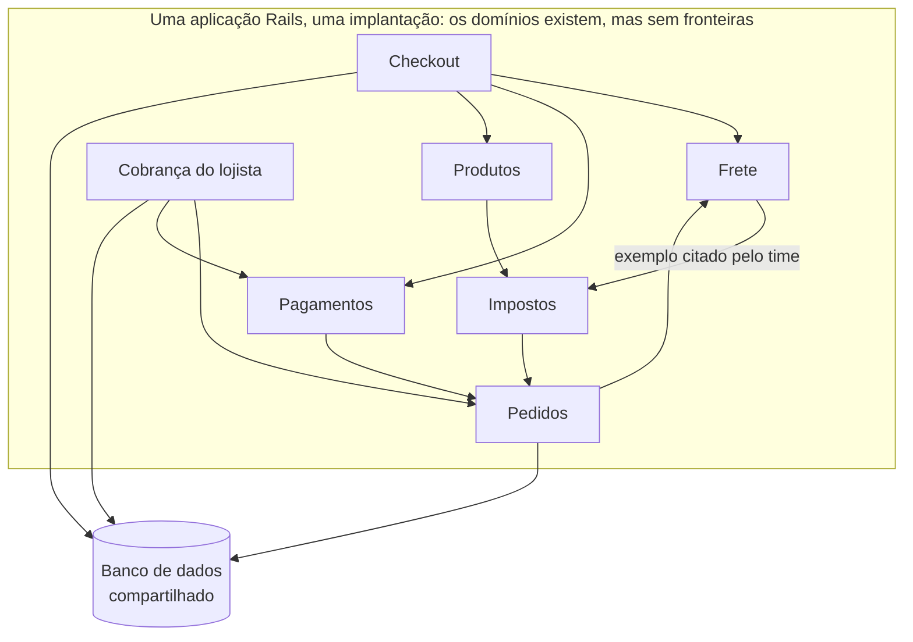
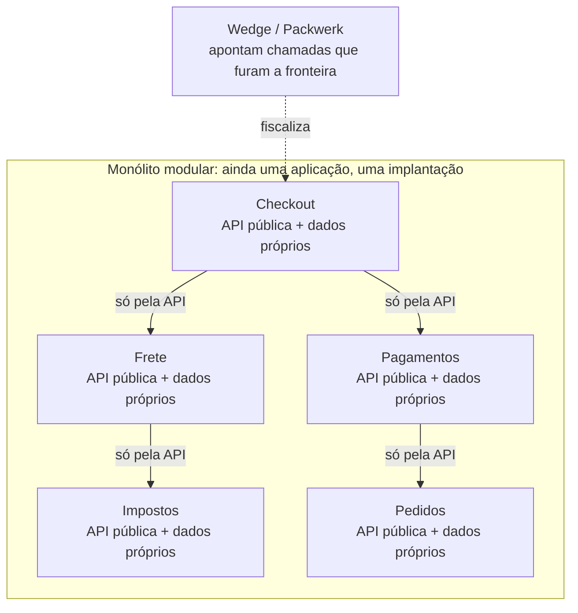
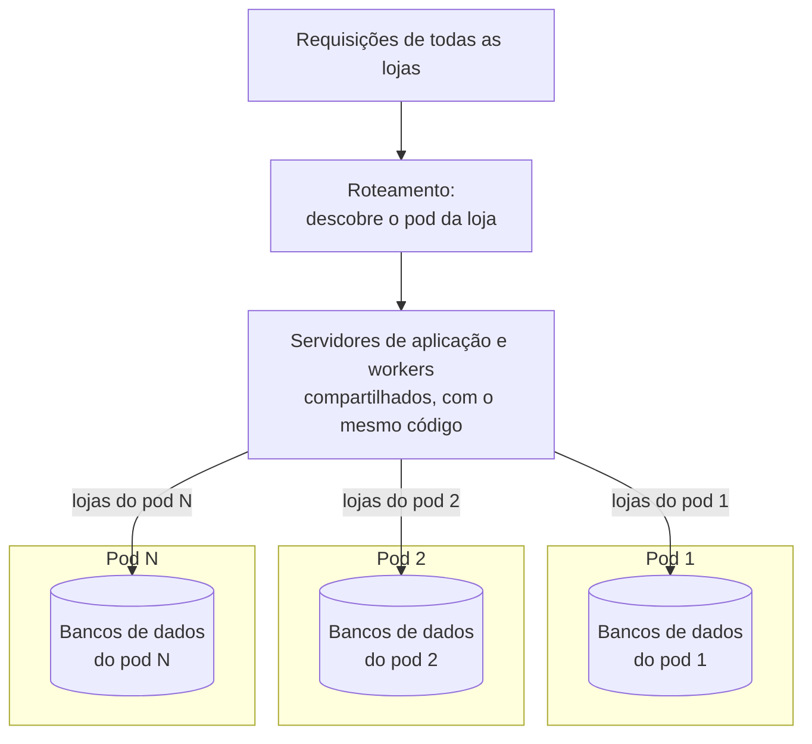
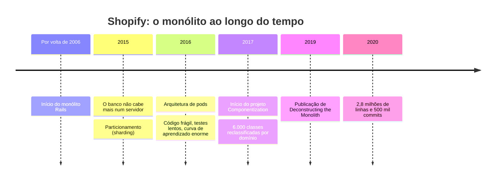

# Dossiê B: Shopify, o Monólito do Núcleo da Plataforma

**Trabalho Prático:** [01-enunciado-trabalho.md](01-enunciado-trabalho.md)

**Período do caso:** os problemas ficaram evidentes em 2016; a reorganização começou em 2017 e foi documentada pelo time de engenharia a partir de 2019.

> 📊 **Sobre os diagramas deste dossiê:** são simplificados e servem para **visualizar a estrutura** (o que existe e como as partes se ligam). Os nomes de domínio e as setas são ilustrativos, exceto onde o texto cita o exemplo do time. Eles **não mostram a análise**: os quanta, o estilo da Aula 06 e o *trade-off* são com vocês.

---

## 1. O Contexto de Negócio

A Shopify é uma plataforma de comércio eletrônico: lojistas do mundo inteiro usam o sistema para montar a loja virtual, cadastrar produtos, vender, cobrar e enviar pedidos.

O núcleo da plataforma é **uma única aplicação Ruby on Rails**, desenvolvida continuamente desde por volta de 2006. Ela reúne funcionalidades de domínios muito diferentes:

* cobrança dos lojistas;
* gestão dos aplicativos de terceiros instalados nas lojas;
* cadastro e atualização de produtos;
* *checkout*, impostos e frete.

**Alguns números públicos:**
* Mais de **mil desenvolvedores** trabalharam nesse código ao longo de mais de uma década.
* Em 2020, o monólito principal tinha cerca de **2,8 milhões de linhas de Ruby** e **500 mil *commits***.
* A plataforma enfrenta **vendas relâmpago** (*flash sales*) com volumes de tráfego grandes e imprevisíveis.

---

## 2. A Arquitetura Original

O código estava organizado como uma aplicação Rails típica: **por conceitos técnicos** (*models*, *views*, *controllers*). Todo o código ficava no mesmo repositório, era implantado de uma vez e usava um banco de dados compartilhado.

**O que funcionava bem**, segundo o próprio time:
* Um único repositório, fácil de pesquisar.
* Uma única esteira de testes e de implantação para manter.
* Um único conjunto de infraestrutura para operar.
* Qualquer dado estava a uma consulta de distância no banco compartilhado.
* Um componente chamava outro diretamente, sem passar pela rede: sem versionamento de API e sem latência de chamadas remotas.

---

## 3. O Problema (2016)

Com o crescimento do código e do time, surgiram sinais de alerta:

* **Fragilidade:** uma mudança aparentemente inofensiva disparava uma cascata de falhas em testes sem relação com ela. Exemplo dado pelo time: se o cálculo do frete chamava o cálculo de impostos, mudar a regra de impostos podia alterar o frete, sem que ficasse claro por quê.
* **Testes lentos e difíceis de escrever**, por causa do alto acoplamento.
* **Curva de aprendizado enorme:** quem entrava no time de frete precisava entender também como os pedidos eram criados, como os pagamentos eram processados e muito mais, porque tudo estava entrelaçado.

O diagnóstico do time: todos os problemas vinham da **falta de fronteiras** entre funcionalidades distintas.

**Como era o código, por dentro:**

> Qualquer parte do código pode chamar qualquer outra, e não existe regra para as setas. Mudar **Impostos** pode quebrar **Frete** sem que ninguém perceba o porquê.

---

## 4. A Decisão: Microsserviços? Não.

O time avaliou microsserviços, que estavam em alta. A conclusão foi que eles **resolveriam os problemas atuais, mas trariam outros**:

* Seria preciso manter **várias esteiras de teste e de implantação**.
* Cada serviço exigiria **infraestrutura própria** para operar.
* Nem sempre o dado necessário estaria disponível na hora certa.
* Cada chamada entre serviços passaria pela **rede**, aumentando a latência e reduzindo a confiabilidade.
* Refatorações que atravessam vários serviços seriam trabalhosas e exigiriam **coordenar implantações**.

**O que escolheram:** transformar o sistema num **monólito modular**. O código continua numa única aplicação, com uma única implantação, mas com **fronteiras rígidas entre domínios**.

---

## 5. Como Fizeram: o Projeto *Componentization*

1. **Pesquisa com os desenvolvedores (2016–2017):** antes de decidir, o time perguntou aos desenvolvedores quais eram as principais dores, para basear a decisão em dados e não em impressões.
2. **Reorganização por domínio:** o código deixou de ser organizado por *models/views/controllers* e passou a ser organizado por **conceitos de negócio** (pedidos, frete, estoque, cobrança). As cerca de **6.000 classes Ruby** foram listadas numa planilha e classificadas manualmente, uma a uma, no componente correto. A mudança foi aplicada num único *pull request* gigante, gerado por *scripts*.
   * *Efeito colateral:* parte do histórico do Git no GitHub se perdeu, porque as movimentações de arquivos foram registradas como exclusões e criações.
3. **Isolamento:** cada componente passou a ter uma **interface pública** e a ser o **único dono dos seus dados**. Outros componentes só podem usá-lo através dessa interface.
4. **Ferramentas de fiscalização:** o time criou ferramentas internas que analisam as chamadas entre componentes e apontam **violações de fronteira** (ex.: Wedge, e depois o Packwerk, que a Shopify publicou como código aberto).

**Resultado concreto citado:** o motor de cálculo de impostos, antigo e inadequado, foi **substituído por um sistema completamente novo**, algo que antes era considerado quase impossível.

**Como ficou o código, por dentro:**

> As caixas continuam na mesma aplicação, mas agora cada uma tem uma **porta de entrada** (a API pública) e é dona dos seus dados. É por isso que trocar o motor de **Impostos** inteiro se tornou possível.

---

## 6. E a Escala? Os *Pods*

A modularização resolve o problema do **código**, mas não o da **carga**. Para isso, a Shopify tomou outra decisão, em paralelo:

* Em 2015, não era mais possível comprar um servidor de banco de dados maior. A empresa precisou **particionar o banco** (*sharding*).
* Em 2016, reorganizou a execução em ***pods***: cada *pod* é um conjunto de lojas com **seus próprios bancos de dados isolados**.
* Servidores de aplicação e *workers* são compartilhados, mas **cada requisição só fala com um único *pod***. Nada atravessa *pods*.
* Uma ferramenta move um *pod* inteiro para outro data center em cerca de um minuto, sem perder requisições.
* Com mais de cem *pods*, o time relatou que, desde a adoção dessa arquitetura, não houve uma grande queda que afetasse a Shopify inteira.

**Como funcionam os *pods*:**

> Cada requisição fala com **um único *pod***. Nenhuma seta liga um *pod* a outro.

**Linha do tempo do caso:**

---

## 7. A Lição que o Time Tira

* No começo de um sistema, **pouca arquitetura** costuma ser a melhor arquitetura: o importante é chegar rápido ao cliente.
* O melhor momento para reestruturar é **o mais tarde possível**, porque o time aprende mais sobre o domínio a cada dia.
* Monólito, monólito modular e arquiteturas orientadas a serviços formam uma **escala evolutiva**: cada uma serve para um tamanho de time e de sistema, e a passagem de uma para outra é marcada por um período de dor.

---

## 8. Perguntas para Guiar a Análise

> Use estas perguntas como ponto de partida. A entrega segue o [template](05-templates.md).

* Qual tipo de **particionamento** (Seção 1.2 da Aula 06) a Shopify tinha antes e qual passou a ter depois?
* O monólito modular é um dos estilos da Aula 06? A qual ele se parece mais, e onde é diferente?
* Aplique o **teste do "e se cair?"** ao monólito. Agora aplique aos ***pods***: se o banco do *pod* 3 cair, o que acontece com as lojas do *pod* 7? O que isso diz sobre o número de quanta?
* Compare os argumentos do time contra microsserviços com as **8 falácias da computação distribuída**. Quais delas o time citou, mesmo sem usar esse nome?
* Monte a tabela **antes × depois** com as estrelas da matriz da Aula 06. O que a Shopify **ganhou** com a modularização e os *pods*, e que característica ela **aceitou sacrificar** ao manter tudo numa única implantação?
* Releia as desvantagens do **particionamento técnico** (Seção 1.2 da Aula 06) e a armadilha **"Monólito Distribuído"** (Seção 3.5). Qual dos dois problemas a Shopify viveu, e qual ela evitou ao não migrar para microsserviços?

---

## Fontes

* [Deconstructing the Monolith: Designing Software that Maximizes Developer Productivity](https://shopify.engineering/deconstructing-monolith-designing-software-maximizes-developer-productivity) – Kirsten Westeinde, Shopify Engineering, fevereiro de 2019
* [Under Deconstruction: The State of Shopify's Monolith](https://shopify.engineering/shopify-monolith) – Philip Müller, Shopify Engineering, 2020
* [A Pods Architecture To Allow Shopify To Scale](https://shopify.engineering/a-pods-architecture-to-allow-shopify-to-scale) – Shopify Engineering
* [E-Commerce at Scale: Inside Shopify's Tech Stack](https://shopify.engineering/e-commerce-at-scale-inside-shopifys-tech-stack) – Shopify Engineering
* [Engineering Leadership and Refactoring Monoliths with Kirsten Westeinde](https://hanselminutes.com/862/engineering-leadership-and-refactoring-monoliths-with-kirsten-westeinde) – podcast Hanselminutes, outubro de 2022
